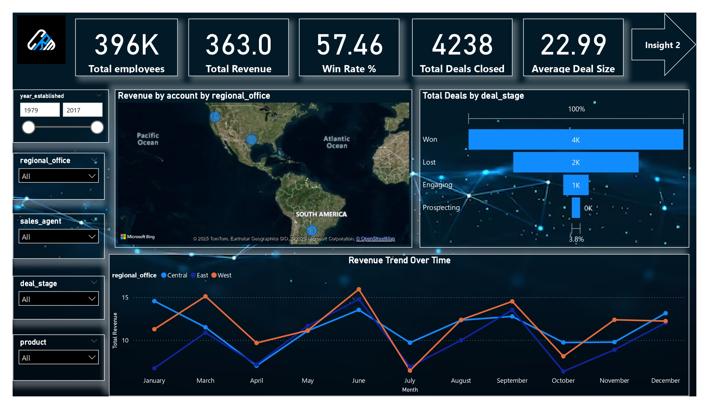
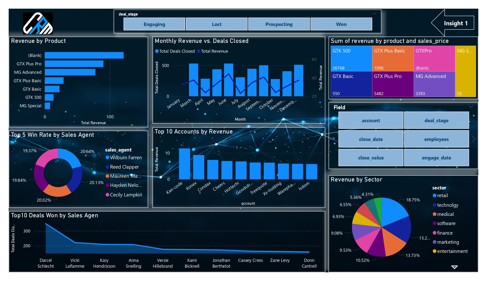

# CRM Sales Dashboard Analytics

<p align="center">
  
  
  
  
</p>

<p align="center">
  <strong>An end-to-end CRM sales analytics project combining pipeline data, account intelligence, Python preparation, MySQL storage, and an interactive Power BI dashboard.</strong>
  <br>
  The project analyzes 7,375 sales opportunities across 85 accounts, 35 sales-team records, and 7 products to support revenue, agent, regional, sector, and deal-stage decisions.
</p>

---

## Table of Contents

- [About This Project](#about-this-project)
- [Problem Statement](#problem-statement)
- [Business Questions](#business-questions)
- [Dataset Overview](#dataset-overview)
- [Project Structure](#project-structure)
- [Methodology](#methodology)
  - [1. Data Cleaning and Preparation](#1-data-cleaning-and-preparation)
  - [2. MySQL Data Loading](#2-mysql-data-loading)
  - [3. KPI and Dashboard Development](#3-kpi-and-dashboard-development)
- [Dashboard Overview](#dashboard-overview)
- [Key Findings](#key-findings)
- [Business Recommendations](#business-recommendations)
- [Technical Specifications](#technical-specifications)
- [How to Review the Project](#how-to-review-the-project)
- [Limitations](#limitations)
- [License](#license)

---

## About This Project

This project evaluates CRM sales performance by bringing sales opportunities, account profiles, products, sales agents, managers, and regional offices into a unified analytical model.

The final Power BI dashboard enables users to examine:

- Revenue and account contribution
- Sales-pipeline deal stages
- Monthly revenue and deal trends
- Regional-office performance
- Sales-agent productivity and win rates
- Product and sector contribution
- Account establishment periods

The project demonstrates:

- **Data preparation:** Cleaning and transforming CRM datasets with Python and Pandas.
- **Data management:** Loading prepared data into MySQL with SQLAlchemy and PyMySQL.
- **Business analysis:** Examining deal outcomes, revenue concentration, and product or agent performance.
- **Power BI reporting:** Building interactive KPIs, slicers, charts, and geographic analysis.
- **Business interpretation:** Translating dashboard patterns into practical sales actions.

---

## Problem Statement

CRM activity can be difficult to interpret when account, pipeline, product, agent, and regional information is stored across separate tables or files.

Sales leadership needs a consolidated view that answers questions such as:

- Which opportunities, accounts, products, agents, and regions contribute the most?
- How many opportunities are won, lost, engaged, or still in prospecting?
- How does revenue change over time?
- Which agents have the strongest conversion performance?
- Where should sales teams focus their pipeline activity?

This project uses cleaned CRM records and an interactive report to provide a clear, measurable view of sales performance.

---

## Business Questions

1. **Revenue Performance:** What is the total account and closed-deal revenue, and how does revenue vary over time?
2. **Deal-Stage Analysis:** How are opportunities distributed across Won, Lost, Engaging, and Prospecting stages?
3. **Regional Performance:** Which regional offices and account locations contribute the most revenue?
4. **Agent Performance:** Which sales agents generate the greatest deal revenue and win rates?
5. **Product Performance:** Which product and product series contribute the most closed-won revenue?
6. **Account and Sector Analysis:** Which accounts and sectors account for the largest share of revenue and employees?

---

## Dataset Overview

The project uses five primary analytical datasets.

| Dataset | Description |
|---|---|
| `Sales_pipeline_cleaned.csv` | 7,375 opportunity-level CRM records with agent, product, account, deal stage, engagement date, close date, and close value |
| `Accounts_cleaned.csv` | 85 account records with sector, establishment year, revenue, employee count, and location |
| `sales_teams.csv` | 35 sales-agent records with manager and regional-office assignments |
| `products.csv` | 7 products with product series and suggested retail price |
| `data_dictionary.csv` | Field-level source definitions for the CRM tables |

### Dataset Summary

| Attribute | Details |
|---|---|
| Sales opportunities | 7,375 |
| Accounts | 85 |
| Sales agents | 35 |
| Products | 7 |
| Regional offices | Central, East, and West |
| Dataset source format | CSV |
| Dashboard data source | MySQL tables or direct Power BI refresh |

### Deal-Stage Distribution

| Deal stage | Opportunity records |
|---|---:|
| Won | 4,238 |
| Lost | 2,473 |
| Engaging | 501 |
| Prospecting | 163 |

---

## Project Structure

```text
CRM-Sales-Analytics/
│
├── assets/
│   ├── crm_project_page-0002.jpg
│   └── crm_project_page-0003.jpg
│
├── dataset/
│   ├── raw/
│   │   ├── sales_teams.csv
│   │   ├── products.csv
│   │   └── data_dictionary.csv
│   └── processed/
│       ├── Accounts_cleaned.csv
│       └── Sales_pipeline_cleaned.csv
│
├── notebooks/
│   ├── Data_Cleaning.ipynb
│   └── Database_Connection.ipynb
│
├── powerbi/
│   └── crm_sales_dashboard.pbix
│
├── .env.example
├── .gitignore
├── LICENSE
├── requirements.txt
└── README.md
```

---

## Methodology

### 1. Data Cleaning and Preparation

The data-cleaning notebook prepares the CRM sources for reporting and analysis. Key preparation areas include:

- Reviewing source fields and data types
- Loading CSV data with Pandas
- Cleaning account and pipeline records
- Standardizing fields used in reporting
- Producing cleaned account and sales-pipeline datasets

**Outputs:**

- `dataset/processed/Accounts_cleaned.csv`
- `dataset/processed/Sales_pipeline_cleaned.csv`

### 2. MySQL Data Loading

The database notebook loads the CRM datasets into MySQL using SQLAlchemy and PyMySQL.

The loading process:

- Reads database settings from a local `.env` file
- Creates a MySQL engine connection
- Reads the prepared CSV files
- Creates or replaces the corresponding analytical tables

**Tables created:**

| Table | Source |
|---|---|
| `accounts` | Accounts_cleaned.csv |
| `sales_pipeline` | Sales_pipeline_cleaned.csv |
| `sales_teams` | sales_teams.csv |
| `products` | products.csv |
| `data_dictionary` | data_dictionary.csv |

### 3. KPI and Dashboard Development

The Power BI dashboard combines the CRM tables to create:

- Sales KPI cards
- Opportunity-stage distribution
- Revenue trends over time
- Geographic account performance
- Revenue by account and sector
- Product revenue and sales-price analysis
- Top-agent and top-account rankings

The report is designed to compare revenue, deal volume, win rate, and stage activity together rather than relying on a single measure.

---

## Dashboard Overview

### Sales Performance Overview



The overview page provides:

- Total employees represented
- Total account revenue
- Win-rate KPI
- Total deals closed
- Average deal size
- Revenue by regional office
- Total opportunities by deal stage
- Revenue trend by month
- Regional and period filters

### Agent and Product Analytics



The analytical page provides:

- Revenue by product
- Monthly revenue compared with deals closed
- Product and sales-price treemap
- Top five sales agents by win rate
- Top 10 accounts by revenue
- Top 10 deals won by sales agent
- Revenue distribution by sector

---

## Key Findings

### Overall KPI Summary

| Metric | Dashboard result |
|---|---:|
| Total employees represented | 396K |
| Total account revenue | 363M |
| Win rate | 57.46% |
| Total deals closed | 4,238 |
| Average deal size | 22.99 |

### Deal-Stage Performance

- Won opportunities make up 57.46% of all 7,375 pipeline records.
- Lost opportunities represent 2,473 records.
- Engaging and Prospecting opportunities remain active pipeline opportunities and should be monitored for conversion.

### Agent Performance

Top sales agents by observed win rate include:

| Sales agent | Recorded opportunities | Won opportunities | Win rate |
|---|---:|---:|---:|
| Wilburn Farren | 82 | 55 | 67.07% |
| Reed Clapper | 237 | 155 | 65.40% |
| Maureen Marcano | 229 | 149 | 65.07% |
| Hayden Neloms | 166 | 107 | 64.46% |
| Cecily Lampkin | 170 | 107 | 62.94% |

**Interpretation:** High-performing agents should be analyzed together with opportunity volume. A smaller set of opportunities can produce a high win rate while contributing less total revenue than a high-volume agent.

### Account and Sector Contribution

- The account dataset represents approximately **363M** in annual revenue and **396K** employees.
- Software, technology, retail, and medical are among the strongest represented sectors by account revenue.
- Kan-code is the leading closed-won account in the pipeline dataset, with approximately **11.28M** in recorded close value.

**Interpretation:** Account concentration and sector mix should be monitored alongside pipeline volume to identify both dependable and emerging opportunities.

### Product Contribution

The leading closed-won product by recorded close value is GTXPro, with approximately **115.90M**, followed by GTX Plus Pro and MG Advanced.

**Interpretation:** The dashboard should compare product revenue, sales price, and deal count rather than use one metric alone.

---

## Business Recommendations

1. **Improve pipeline governance:** Review Engaging and Prospecting opportunities frequently and assign clear ownership and next actions.
2. **Support high-performing agents:** Identify the practices used by leading agents and apply them selectively across the broader sales organization.
3. **Balance volume and conversion:** Evaluate agent performance using win rate, revenue, and deal count together.
4. **Review concentration risk:** Track dependence on the largest accounts and leading products and develop targeted growth opportunities in smaller segments.
5. **Optimize product strategy:** Compare close value with deal volume and suggested sales price when deciding where to focus promotion and selling effort.
6. **Monitor sectors dynamically:** Use sector and regional filters to identify demand shifts rather than treating the overall sales result as the only performance signal.

---

## Technical Specifications

| Component | Technology |
|---|---|
| Dashboard | Microsoft Power BI Desktop |
| Data preparation | Python, Pandas |
| Development environment | Jupyter Notebook / JupyterLab |
| Database | MySQL |
| Database connection | SQLAlchemy, PyMySQL |
| Environment configuration | python-dotenv |
| Modeling utilities | scikit-learn |
| Input/output format | CSV, PBIX, IPYNB |

---

## How to Review the Project

### 1. Review the Source Data

Open the CSV files in `dataset/raw/` and `dataset/processed/` to inspect account, pipeline, product, team, and field-definition records.

### 2. Prepare the Data

Open `notebooks/Data_Cleaning.ipynb` in Jupyter Notebook or JupyterLab and run the preparation cells.

### 3. Configure MySQL

Create a local database:

```sql
CREATE DATABASE crm_sales_db;
```

Copy the environment template:

```powershell
Copy-Item .env.example .env
```

Update `.env`:

```dotenv
DB_USERNAME=root
DB_PASSWORD=your_password
DB_HOST=localhost
DB_PORT=3306
DB_DATABASE=crm_sales_db
```

> Never commit `.env` or real database credentials.

### 4. Load Data into MySQL

Install the Python dependencies:

```powershell
python -m pip install -r requirements.txt
```

Open `notebooks/Database_Connection.ipynb` and run all cells. The notebook creates or replaces the account, pipeline, product, sales-team, and data-dictionary tables.

### 5. Open the Dashboard

Open `powerbi/crm_sales_dashboard.pbix` in Microsoft Power BI Desktop. Refresh or reconfigure the data source if required, then use the report filters to explore performance by region, agent, deal stage, product, sector, and year.

---

## Limitations

- The dataset is a project dataset and may not represent a complete live CRM system.
- Revenue values, account totals, and close values should be interpreted in the context of the available source fields.
- Deal-stage win rate is based on the opportunity records and should not be interpreted as a probability forecast.
- The dataset does not include cost, margin, compensation, or profitability fields.
- Operational measures such as sales-cycle duration and customer retention are not available.
- Geographic and sector findings describe the supplied records and should not be generalized beyond the source dataset.

---

## License

This project is licensed under the terms in [LICENSE](LICENSE).

---

<p align="center">
  <strong>CRM Sales Dashboard Analytics</strong>
  <br>
  Python • MySQL • Power BI • CRM Sales Analysis
</p>
